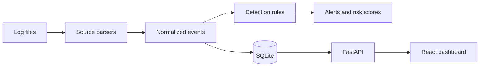

# SentinelTrace

SentinelTrace is an educational defensive security monitoring platform by **Tuncay Sarxanlı**. It imports synthetic or user-supplied Windows Security JSON, Linux authentication logs, and Suricata EVE JSON, normalizes them into a common event model, evaluates explainable detection rules, stores alerts in SQLite, and exposes a FastAPI API with a React SOC dashboard.

> **Status:** The current release implements the backend ingestion/detection/API path, a live overview dashboard, reports, synthetic datasets, tests, Docker configuration, and CI. The dashboard is intentionally focused on the implemented overview surface; advanced explorer and analyst workflow views remain roadmap work.

## Features

- UTC timestamp normalization and duplicate protection.
- Windows IDs 4624, 4625, 4634, 4648, 4672, 4688, 4720, 4728, 4732, and 4740.
- Linux SSH, sudo, invalid-user, and session parsing.
- Suricata alert, DNS, HTTP, TLS, and flow telemetry.
- Explainable authentication, privilege, account, group, and network detections.
- SQLite persistence, paginated event API, alert lifecycle API, investigations, and Markdown/JSON/HTML reports.
- Dark responsive React dashboard backed by real API responses.

## Architecture



## Quick start

```bash
cd backend
python -m venv .venv && . .venv/bin/activate
pip install -r requirements.txt
uvicorn app.main:app --reload
```

In another terminal:

```bash
cd frontend
npm install
npm run dev
```

Open `http://localhost:5173`; API documentation is at `http://localhost:8000/docs`.

Ingestion examples:

```bash
curl -F file=@datasets/windows/sample.jsonl "http://localhost:8000/api/events/ingest?source=windows"
curl -F file=@datasets/linux/sample.log "http://localhost:8000/api/events/ingest?source=linux"
curl -F file=@datasets/network/sample.jsonl "http://localhost:8000/api/events/ingest?source=suricata"
```

## Docker

```bash
docker compose up --build
docker compose logs -f backend
docker compose down
```

## Testing

```bash
make backend-test
make backend-lint
make frontend-install
make frontend-build
```

## Security model and limitations

This is a local educational analysis tool. Uploads are size-limited, parsed without shell execution, HTML reports escape untrusted content, and ORM queries are parameterized. It does not authenticate users yet, does not execute remediation, and does not claim that any event or score proves compromise. Deploy behind an authenticated reverse proxy and use PostgreSQL plus migrations before multi-user production use.

## Roadmap

Authentication, Alembic migrations, richer explorer/timeline pages, persisted rule configuration, streaming uploads, and analyst note workflows are planned.

## License

MIT. See `LICENSE`.
