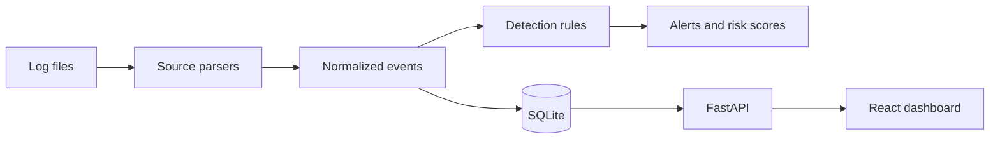

# SentinelTrace

SentinelTrace is an educational defensive security monitoring platform by **Tuncay Sarxanlı**. It imports synthetic or user-supplied Windows Security JSON, Linux authentication logs, and Suricata EVE JSON, normalizes them into a common event model, evaluates explainable detection rules, stores alerts in SQLite, and exposes a FastAPI API with a React SOC dashboard.

> **Status:** The current release implements authenticated local analyst access, Alembic migrations, persisted detection-rule controls, streaming ingestion, advanced event filtering, a live overview/events dashboard, reports, synthetic datasets, tests, Docker configuration, and CI.

## Features

- UTC timestamp normalization and duplicate protection.
- Windows IDs 4624, 4625, 4634, 4648, 4672, 4688, 4720, 4728, 4732, and 4740.
- Linux SSH, sudo, invalid-user, and session parsing.
- Suricata alert, DNS, HTTP, TLS, and flow telemetry.
- Explainable authentication, privilege, account, group, and network detections.
- SQLite persistence, paginated event API, alert lifecycle API, investigations, and Markdown/JSON/HTML reports.
- Password-hashed local authentication with first-run administrator provisioning and analyst/admin authorization.
- Persisted rule enable/disable settings and correlated investigation timelines.
- Streaming uploads with configurable limits (`MAX_UPLOAD_BYTES`) and advanced event search/filtering.
- Dark responsive React dashboard backed by real API responses, authentication, and Events Explorer.

## Architecture



## Quick start

```bash
cd backend
python -m venv .venv && . .venv/bin/activate
pip install -r requirements.txt
alembic upgrade head
uvicorn app.main:app --reload
```

In another terminal:

```bash
cd frontend
npm install
npm run dev
```

Open `http://localhost:5173`; API documentation is at `http://localhost:8000/docs`.

Ingestion examples:

```bash
curl -F file=@datasets/windows/sample.jsonl "http://localhost:8000/api/events/ingest?source=windows"
curl -F file=@datasets/linux/sample.log "http://localhost:8000/api/events/ingest?source=linux"
curl -F file=@datasets/network/sample.jsonl "http://localhost:8000/api/events/ingest?source=suricata"
```

On first run, use `POST /api/auth/register` once to create the local administrator. Subsequent users are created by an administrator through `POST /api/auth/users`. Set `AUTH_SECRET` to a long random value for persistent sessions across restarts.

## Docker

```bash
docker compose up --build
docker compose logs -f backend
docker compose down
```

## Testing

```bash
make backend-test
make backend-lint
make frontend-install
make frontend-build
```

## Security model and limitations

This is a local educational analysis tool. Uploads are streamed and size-limited, parsed without shell execution, HTML reports escape untrusted content, ORM queries are parameterized, and security headers/trusted hosts are enabled. Passwords use salted scrypt hashes; tokens are signed and delivered through an HttpOnly cookie or bearer response. It does not execute remediation and does not claim that any event or score proves compromise. Deploy behind HTTPS, configure `AUTH_SECRET`, and add operational rate limiting and PostgreSQL before internet-facing use.

## Roadmap

Operational distributed rate limiting, password reset/revocation, richer alert/event detail visualizations, and full analyst note history remain planned.

## License

MIT. See `LICENSE`.
